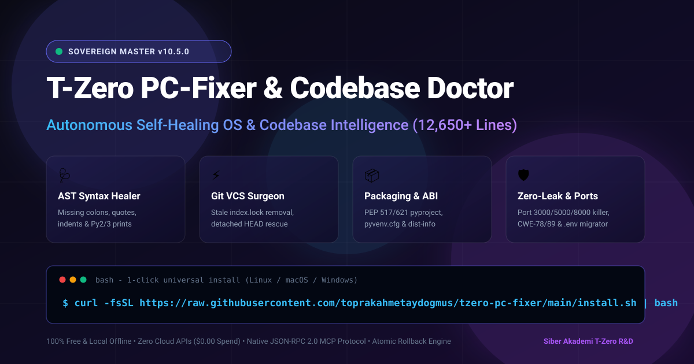
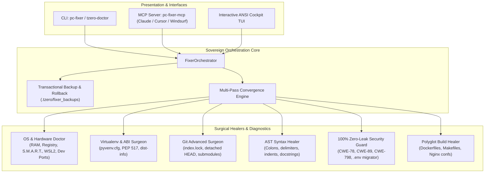

# 🩺 T-Zero PC-Fixer & Codebase Doctor
### *Autonomous Self-Healing Operating System & Codebase Doctor (12,650+ Lines Master Edition)*

[](https://github.com/toprakahmetaydogmus/tzero-pc-fixer/actions)
[](https://pypi.org)
[](https://opensource.org/licenses/MIT)
[](tzero_pc_fixer.py)
[](https://github.com/toprakahmetaydogmus/tzero-pc-fixer)
[-blueviolet.svg)](https://github.com/toprakahmetaydogmus/tzero-pc-fixer)
[](pc_fixer_mcp.py)

<p align="center">
  
</p>


---

## 🌟 Executive Overview

**T-Zero PC-Fixer & Codebase Doctor** is an encyclopedic, industrial-grade autonomous self-healing engine and Model Context Protocol (MCP) server. It diagnoses and fixes computer environments, developer toolchains, virtual environments, Git version control issues, AST syntax errors, PEP 517 packaging conflicts, and OWASP/CWE security vulnerabilities with **zero external dependencies** and **$0.00 cloud cost**.

Available as both a **single-file monolithic executable (`tzero_pc_fixer.py`, 12,657 lines)** and a **modular Python package (`tzero_fixer/`)**, it delivers surgical repair recipes with full transactional rollback safety.

---

## 🏗 System Architecture



---

## 🚀 Key Capabilities

1. **AST Syntax & Delimiter Surgical Healer:** Automatically detects and repairs missing colons, unbalanced brackets/parentheses, indentation errors, and unclosed quotes.
2. **Virtual Environment & ABI Doctor:** Detects corrupted `pyvenv.cfg`, resolves conflicting or duplicate `.dist-info` directories in site-packages, and handles PEP 517/621 build-backend injection.
3. **Git VCS Advanced Surgeon:** Cleans stale `.git/index.lock` and `.git/HEAD.lock` after crashes, rescues detached HEAD states into safe branches, and generates `.gitattributes` for universal cross-platform line ending normalization.
4. **Dev Port & Hardware Doctor:** Identifies and terminates rogue processes locking developer ports (3000, 5000, 8000, 8080), monitors physical disk partition space, and detects WSL2 `.vhdx` storage expansion.
5. **100% Zero-Leak Security Guard:** Scans AST code for 60+ high-entropy API key patterns (AWS, OpenAI, Anthropic, Gemini, GitHub, Stripe, DB URIs) and migrates them safely into `.env` with automatic `os.environ.get()` replacement.
6. **Polyglot Build & Container Healer:** Repairs Makefile space-to-tab indentation traps, generates high-efficiency `.dockerignore` files, and audits Nginx reverse proxy configurations for missing semicolons.
7. **Transactional Atomic Rollback:** Backs up all modified files into `.tzero/fixer_backups/<tx_id>/` before touching disk, enabling 1-second atomic rollbacks via `--rollback <tx_id>`.

---

## 📦 Installation

### Option 1: Universal 1-Click Installer (Recommended)
**Linux & macOS:**
```bash
curl -fsSL https://raw.githubusercontent.com/toprakahmetaydogmus/tzero-pc-fixer/main/install.sh | bash
```

**Windows (PowerShell):**
```powershell
irm https://raw.githubusercontent.com/toprakahmetaydogmus/tzero-pc-fixer/main/install.ps1 | iex
```

### Option 2: Install via Pip
```bash
pip install tzero-pc-fixer
```

### Option 3: Single-File Zero-Dependency Standalone
Download the single-file masterpiece `tzero_pc_fixer.py` directly without installing any packages:
```bash
curl -O https://raw.githubusercontent.com/toprakahmetaydogmus/tzero-pc-fixer/main/tzero_pc_fixer.py
python tzero_pc_fixer.py --help
```

### Option 4: From Source
```bash
git clone https://github.com/toprakahmetaydogmus/tzero-pc-fixer.git
cd tzero-pc-fixer
pip install -e .
```

---

## 💻 Command-Line Interface (CLI)

```bash
# 1. Run complete workspace diagnostic check
pc-fixer .

# 2. Autonomously heal all detected defects with atomic backup
pc-fixer --heal

# 3. Simulate self-healing without touching files on disk
pc-fixer --heal --dry-run

# 4. Roll back any previously executed healing transaction
pc-fixer --rollback tx_1793900379_d7337d

# 5. Output reports in SARIF v2.1.0 (for GitHub Security tab) or JUnit XML
pc-fixer --format sarif --out results.sarif
pc-fixer --format junit --out results.xml

# 6. Install Git pre-commit zero-leak & syntax quality gate
pc-fixer --install-hook

# 7. Generate GitHub Actions CI quality workflow
pc-fixer --generate-ci

# 8. Run synthetic stress benchmarks
pc-fixer --benchmark
```

---

## 🔌 Model Context Protocol (MCP) Server Setup

T-Zero PC-Fixer exposes a fully compliant JSON-RPC 2.0 stdio MCP server for AI IDEs and assistants:

### Claude Desktop
Add to your `claude_desktop_config.json`:
```json
{
  "mcpServers": {
    "pc-fixer": {
      "command": "python",
      "args": ["-m", "tzero_fixer.mcp_server"]
    }
  }
}
```

### Cursor & Windsurf
Add to your workspace `.cursor/mcp.json` or Windsurf global config:
```json
{
  "mcpServers": {
    "pc-fixer": {
      "command": "pc-fixer-mcp"
    }
  }
}
```

### Available MCP Tools
- `pc_fixer_diagnose`: Deep multi-tier workspace and OS diagnostics.
- `pc_fixer_auto_heal`: Autonomous surgical self-healing with rollback manifest.
- `pc_fixer_rollback`: Transactional atomic rollback using transaction UUID.
- `pc_fixer_check_system`: Hardware health, disk partition space, and dev port conflicts.
- `pc_fixer_cwe_audit`: Static AST CWE-78/89/22/798 vulnerability scanner.
- `pc_fixer_kill_port_process`: Terminate processes locking dev ports (3000, 5000, etc.).
- `pc_fixer_clean_git_locks`: Detect and safely delete stale Git lock files.

---

## 📊 Comprehensive Capability Matrix

| Feature | T-Zero PC-Fixer | Ruff | Black | Bandit | Snyk |
| :--- | :---: | :---: | :---: | :---: | :---: |
| **Dependencies Required** | **0 (Zero)** | 1+ | 5+ | 8+ | Node/Cloud |
| **Cloud Cost / Subscriptions** | **$0.00 Free** | Free | Free | Free | Paid |
| **AST Syntax Error Repair** | **Yes** | No | No | No | No |
| **Virtualenv & pyvenv.cfg Repair** | **Yes** | No | No | No | No |
| **Git Stale Lock Removal** | **Yes** | No | No | No | No |
| **Dev Port Conflict Termination** | **Yes** | No | No | No | No |
| **CWE / OWASP Vulnerability Check** | **Yes** | Partial | No | Yes | Yes |
| **Zero-Leak Secret Migration to .env** | **Yes** | No | No | No | No |
| **Transactional Atomic Rollback** | **Yes** | No | No | No | No |
| **Native MCP Server Support** | **Yes** | No | No | No | No |

---

## 🔒 100% Zero-Leak Security & Privacy Policy

1. **Zero External Data Transmission:** 100% of all diagnostics, AST parsing, and code repairs run locally offline on your device.
2. **Zero Paid Cloud API Calls:** No external LLM credits, subscriptions, or API tokens are required.
3. **No Secret Telemetry:** No user analytics, metrics, or logs are transmitted to any external server.

---

## 🧪 Running Tests

```bash
# Run all unit and integration tests
python -m unittest discover -s tests -p "test_*.py" -v
```

---

## 📄 License

Distributed under the **MIT License**. See [`LICENSE`](LICENSE) for details.
Crafted with passion by Toprak Ahmet Aydogmus & Siber Akademi T-Zero R&D Team.

